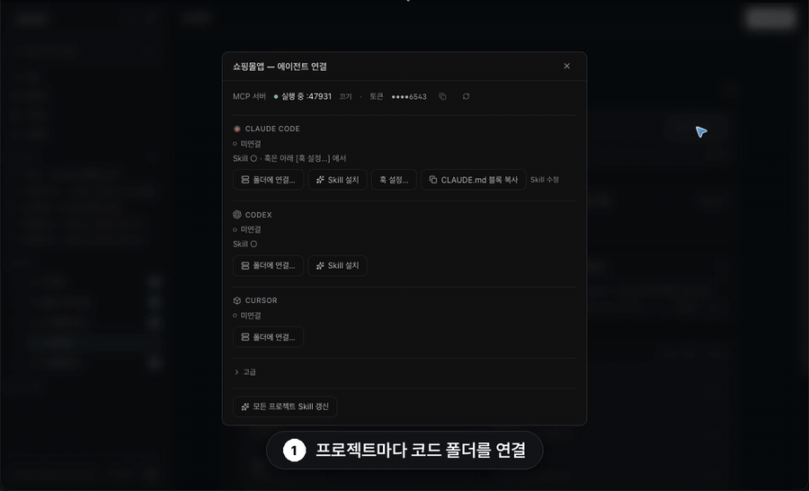
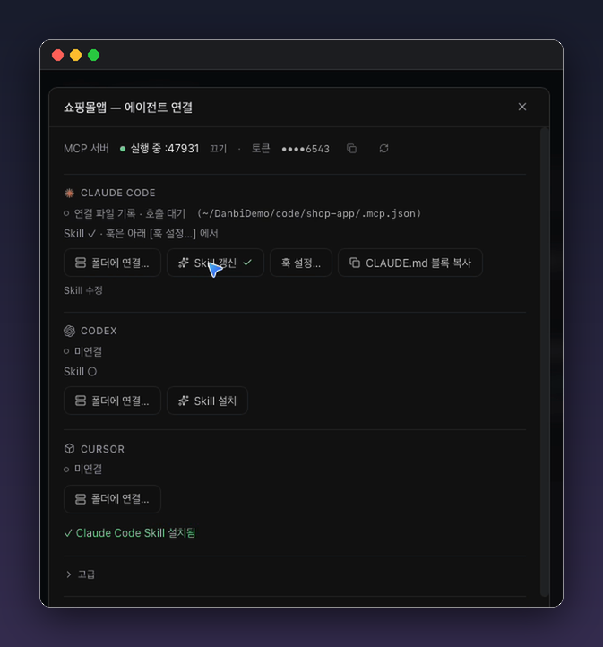
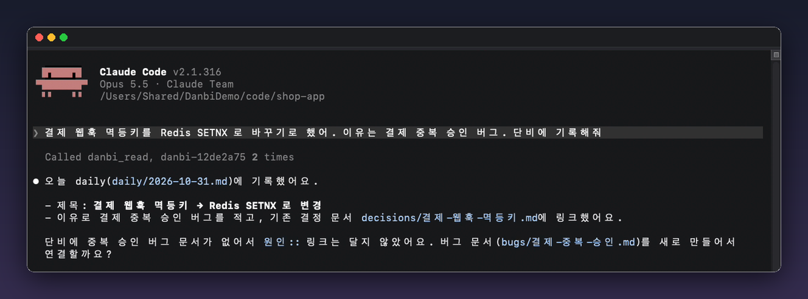
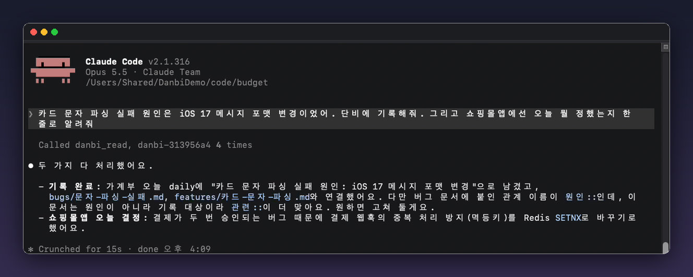
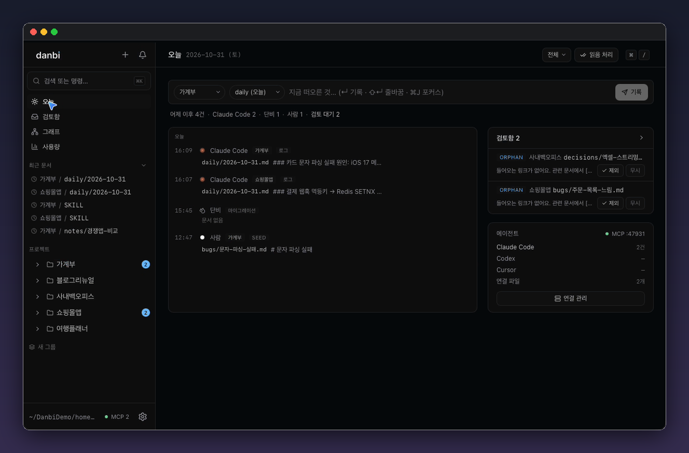
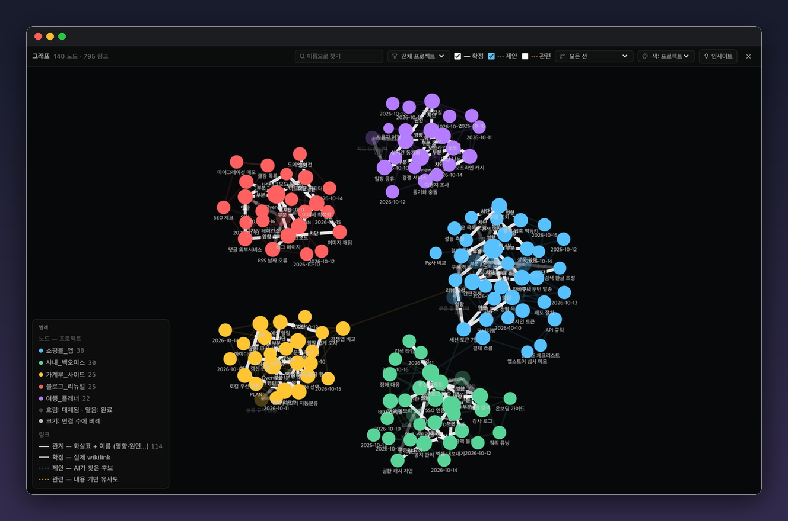
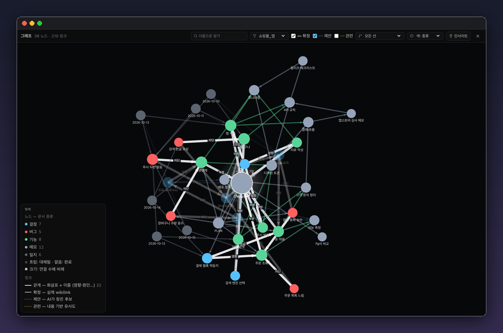

<p align="center">
  
</p>

<p align="center">
  
</p>

<p align="center">
  <b>사이드 프로젝트 여러 개를 Claude Code · Codex 로 굴리는 사람을 위한 LLM 위키.</b><br/>
  프로젝트마다 따로 기억하고, AI 가 직접 적고 꺼내 씁니다. 설치는 DMG 하나로 끝.
</p>

<p align="center">
  <a href="https://github.com/dean-studio/danbi/releases/latest">
    
  </a>
</p>

<p align="center">
  <sub>
    Apple Silicon · macOS 11+ ·
    <a href="https://github.com/dean-studio/danbi/releases">전체 버전</a> ·
    <a href="CHANGELOG.md">변경 기록</a> ·
    <a href="LICENSE">MIT</a>
  </sub>
</p>

<br/>

<p align="center">
  
</p>
<p align="center"><sub>코드 폴더 연결 → 각 폴더의 Claude Code 가 자기 프로젝트에만 기록 → 단비에서 기록·그래프 확인 · <a href="readme_imgs/danbi-demo.mp4">전체 영상 (1분 40초)</a></sub></p>

<br/>

## 새로: 약속 · 출처 · 기록 재촉 (다음 버전)

> 에이전트는 매 세션 처음부터 시작합니다. 대표님이 지난주에 고쳐 준 것, "이건 절대 하지 마" 라고 한 것도 새 세션은 모릅니다. 이제 프로젝트마다 `약속.md` 한 장을 두고, 세션을 열 때마다 그 내용을 맨 앞에 넣어 줍니다. 기록에는 사람이 한 말인지 AI 가 판단한 것인지가 함께 남습니다.

<sub>아직 출시 전입니다. 위 다운로드 버튼(0.11.0)에는 들어 있지 않고, 다음 릴리스에 들어갑니다.</sub>

### 무엇이 바뀌나

| | 지금까지 | 이제 |
|---|---|---|
| 지켜야 할 것 | CLAUDE.md, 에이전트 메모리, daily 여기저기에 흩어짐. 새 세션은 찾아 읽어야 앎 | 프로젝트마다 `약속.md` 한 장. 세션 시작 브리핑 맨 앞에 그대로 들어감 |
| 누가 한 말인지 | 사람이 정한 것과 AI 가 짐작한 것이 같은 모양으로 쌓임 | 기록 끝에 `_출처: 사용자 말 — “…”_` 또는 `_출처: AI 판단_` 이 붙음. 인용이 실제 대화에 없으면 단비가 "AI 판단" 으로 낮춤 |
| 기록을 잊은 긴 세션 | 끝날 때까지 아무것도 안 남기도 함 | 기록 없이 오래 이어진 세션에 한 줄로 "남길 게 있으면 `danbi_log` 로" 를 권함 |

### 약속.md

```markdown
## 사용자
- [#who] 대표님 = 단비 제작자이자 매일 쓰는 사용자

## 지적받은 것
- [#no-llm] 새 기능은 LLM 없이도 동작해야 함 — 클라우드 API 못 쓰는 환경이 많음

## 약속
- [#dmg] DMG 번들링은 대표님이 요청할 때만
```

- 섹션은 세 가지입니다. **사용자**(사람에 대한 사실·역할), **지적받은 것**(에이전트가 틀려서 고쳐 받은 것), **약속**(하기로/안 하기로 정한 작업 규칙).
- 한 줄에 하나씩 짧게 씁니다. 줄 앞에 `[#id]` 를 붙여 두면 에이전트가 `danbi_upsert_item` 으로 같은 줄을 고칠 때 새 줄을 덧붙이지 않고 그 줄을 바꿉니다.
- 브리핑에는 항목이 있는 섹션만 들어갑니다. 안내 주석과 빈 섹션은 빠지고, 900자를 넘으면 뒤는 "나머지는 약속.md" 로 줄입니다. 비어 있는 약속.md 는 브리핑에 아무것도 넣지 않습니다.
- 새 프로젝트를 만들면 빈 골격이 같이 생깁니다. 기존 프로젝트에는 업데이트 후 처음 켤 때 **한 번만** 골격을 깝니다. 이미 있는 파일은 건드리지 않고, 지운 파일을 되살리지도 않습니다. 이 골격 커밋은 활동 기록과 "최근 바뀐 문서" 에 잡히지 않습니다.
- 결정은 `decisions/`, 할 일은 할 일함에 그대로 둡니다. 약속.md 는 매 세션 다시 읽힐 짧은 규칙만 담는 곳입니다.

### 출처: 사람 말과 AI 판단 구분

`danbi_log` 와 `danbi_upsert_item` 에 `source`·`quote` 인자가 생겼습니다.

| 에이전트가 준 것 | 단비가 확인하는 것 | 문서에 붙는 줄 |
|---|---|---|
| `source: "user"` + `quote` | 인용이 최근 Claude Code · Codex 대화의 사용자 메시지에 실제로 있는지 | 있으면 `_출처: 사용자 말 — “…”_` |
| 위와 같은데 대화에서 못 찾음 | — | `_출처: AI 판단 (사용자 말로 확인되지 않음)_` |
| `source: "ai"` | — | `_출처: AI 판단_` |

- 확인은 LLM 없이 합니다. 최근 6시간 안에 바뀐 대화 기록 파일(`~/.claude*/projects`, `~/.codex/sessions`)에서 사용자 메시지만 골라 공백·따옴표를 맞춰 대조합니다. 6자보다 짧은 인용은 메시지 전체와 같을 때만 인정합니다.
- `danbi_upsert_item` 은 출처를 항목 아래 들여쓴 줄로 붙입니다. 첫 줄은 그대로라 `[#id]` 로 다시 찾을 수 있습니다.
- 출처 인자를 주지 않으면 지금과 똑같이 기록합니다.

### 기록 재촉

Claude Code 세션 훅에 `UserPromptSubmit` 이 하나 더 붙습니다. 질문을 보낼 때마다 단비가 그 세션의 대화 기록을 보고, 아래 조건이 모두 맞을 때만 한 줄을 넣습니다.

- 이 세션에서 아직 단비에 기록한 적이 없고
- 도구를 3번 이상 썼고(실제로 일을 했고)
- 질문이 8번째, 16번째, 24번째…일 때

> 단비: 이 세션에서 아직 단비에 남긴 기록이 없어요. 다음 세션이 알아야 할 결정·원인·진행이 생겼으면 danbi_log 로 남기세요 (없으면 무시).

대화 기록 파일의 끝부분(최대 4MB)만 읽고, 1초 안에 답이 없으면 그냥 넘어가 세션을 막지 않습니다. 이미 훅을 설치한 폴더는 프로젝트 연결 화면의 **훅 설정… › 폴더 선택 후 설치** 를 한 번 더 누르면 붙습니다.

### 바뀌지 않는 것

- **LLM 을 부르지 않습니다.** 약속 넣기, 출처 대조, 재촉 판단 모두 파일만 읽습니다.
- **상주 프로세스가 늘지 않습니다.** 훅은 질문할 때 `curl` 한 번이고, 골격 깔기는 앱을 켤 때 한 번 돌고 끝납니다.
- **약속.md 는 사람이 고치는 문서입니다.** 단비는 빈 골격만 깔고 내용을 지어내지 않습니다. 에이전트가 줄을 더해도 모두 git 커밋으로 남아 되돌릴 수 있습니다.

<br/>

## v0.11.0: 쉬는 시간 정리 (dreaming)

> 에이전트는 기억을 쌓기만 했습니다. 이제 단비가 쉬는 시간에 쌓인 기억을 다시 훑어 정리 거리를 찾습니다. 확실한 것은 단비와 에이전트가 처리하고, 판단이 필요한 것만 사람에게 남깁니다. 남은 것도 검토함의 **추천대로 적용** 버튼 하나로 정리할 수 있습니다.

사람이 잠자는 동안 그날 기억을 정리하듯, 단비도 vault 가 조용해지면 기억을 다시 봅니다. 그래서 이름이 dreaming 입니다.

> 💡 **아이디어 출처** — Anthropic Research, [“The components of agent memory”](https://www.anthropic.com/research/components-of-agent-memory). 에이전트가 쉬는 시간에 기억을 다시 훑어 틀린 것은 고치고 깨진 링크를 잇는 "dreaming" 단계가 기억 품질을 지켰다는 실험 결과(위키의 없는 문서를 가리키던 링크 9개를 있는 문서로 고친 사례 포함)를 단비에 옮겼습니다.

### 왜 넣었나

Anthropic 의 [에이전트 메모리 연구](https://www.anthropic.com/research/components-of-agent-memory) 결과와 단비 사용 기록이 같은 문제를 가리켰습니다.

- **많이 적는다고 기억이 좋아지지 않습니다.** 연구에서 메모를 가장 많이 쓴 모델은 오히려 성적이 나빴습니다. 틀린 메모 하나가 같은 실수를 되풀이하게 만들기도 했습니다. 품질을 지킨 건 쉬는 시간에 기억을 다시 훑는 정리 단계였습니다. 틀린 것은 고치고, 오래 쓸 것은 위로 올리고, 깨진 링크는 이었습니다.
- **단비 vault 도 그렇게 자라고 있었습니다.** 39개 프로젝트, 약 1,800 문서, 836만 자를 재 보니 최근 30일 기록은 대부분 에이전트가 MCP 로 쓴 것이었습니다. 사람이 손댄 것은 거의 없었습니다.
- **에이전트는 링크를 폴더 없이 적는 습관이 있습니다.** 실제 파일은 `notes/cron-pipeline.md` 인데 `[[cron-pipeline.md]]` 로 적는 식입니다. 그래서 전체 링크 4,635곳 중 900곳 가까이(약 19%)가 열리지 않고 백링크도 걸리지 않았습니다.
- **daily 노트에 결정이 묻힙니다.** "결정 · 원인 · 노하우" 로 적힌 daily 섹션 1,000건 넘게가 주제 문서로 옮겨지지 않은 채 남아 있었습니다. 시간이 지나면 찾기도 어렵고, 지금도 유효한지 판단하기도 어렵습니다.

### 어떻게 돌아가나

```
 vault 가 20분 조용함 ─▶ 바뀐 프로젝트만 훑기 ─▶ 정리 거리 찾기
                                                │
        ┌───────────────────────────────────────┼─────────────────────────────┐
        ▼                                       ▼                             ▼
 ① 단비가 바로 고침                    ② 에이전트가 처리               ③ 검토함에 남김
 확실한 링크 수리                      일을 마칠 때 danbi_tidy        판단이 필요한 것
 (단비 이름으로 커밋)                  (에이전트 이름·근거로 커밋)     → 추천대로 적용 / 하나씩 고르기
```

단비가 찾는 정리 거리는 세 가지입니다.

| 정리 거리 | 예 | 고치는 방법 |
|---|---|---|
| **깨진 링크** | `[[notes/demo-scrpt.md]]` → 실제로는 `notes/demo-script.md` | git 이름 변경 기록, 대소문자·구분자 차이, 비슷한 이름으로 후보를 찾습니다. 링크만 바꾸고 별칭(`\|별칭`)은 그대로 둡니다. |
| **daily 에 묻힌 결정** | daily 의 `### 배치 결정` 섹션 | `decisions/2026-05-11-배치-결정.md` 같은 주제 문서로 옮기고, daily 에는 링크 한 줄만 남깁니다. |
| **기한 지난 문서** | `stale_after: 2026-10-01` 이 지난 문서, 대체된 결정을 아직 인용하는 문서 | "아직 맞아요"(확인 표시 + 기한 90일 연장), "대체됨" 표시, 새 문서로 링크 바꾸기 중에서 고릅니다. |

### 도입 전과 후

| | 도입 전 | 도입 후 |
|---|---|---|
| 기록 | 에이전트가 쌓기만 함 | 단비가 쉬는 시간에 다시 훑고, 에이전트는 일을 마칠 때 정리 거리를 처리함 |
| 깨진 링크 | 아무도 모름. 열리지 않고 그래프에서도 끊김 | 폴더가 빠진 링크는 같은 이름 파일이 하나뿐이면 그대로 열림. 문서를 고치지 않고 약 490곳이 바로 열려, 안 열리는 링크가 19%에서 9%로 줄었음. 확실한 수리는 단비가 바로 고치고, 나머지는 "이걸로 바꿀까요?" 로 올라옴 |
| daily 에 묻힌 결정 | daily 속에 그대로 남음 | 에이전트가 옮기거나 검토함에 "옮길까요?" 로 올라옴. 옮기면 주제 문서가 생기고 daily 에는 링크 한 줄이 남음 |
| 기한 지난 문서 | 검색에서 뒤로 밀리기만 함 | "아직 맞나요?" 로 올라옴. 사람이 확인하거나, 에이전트가 근거를 적고 확인함 |
| 검토함 | 항목마다 하나씩 눌러야 함. 사이드바 숫자가 검토함과 따로 놀았음 | 맨 위 **추천대로 적용** 버튼 하나로 정리. 사이드바 숫자는 검토함과 같은 기준으로 세고 처리하면 바로 줄어듦 |
| 기억 크기 | 얼마나 불어나는지 보이지 않음 | 프로젝트 홈의 **기록 건강** 카드와 홈의 **불어나는 프로젝트** 카드. 에이전트도 `danbi_briefing` 으로 같은 요약을 받음 |
| 에이전트에게 주는 안내 | 규칙 표, 금지 목록, 안티 패턴이 길게 붙은 CLAUDE.md · SKILL.md | 용도와 도구 이름만 남긴 짧은 안내(CLAUDE.md 블록 6,449 → 1,333자, SKILL.md 7,678 → 1,350자). 세부는 도구 설명으로 |

<sub>숫자는 2026-11-07 실제 vault 복제본(39개 프로젝트)에서 잰 값입니다. 첫 정리에서 찾은 정리 거리는 깨진 링크 223건과 묶음 2개, daily → 주제 문서 옮기기 1,044건이었습니다. 어디서도 링크되지 않던 문서는 228개에서 204개로 줄었습니다. 39개 프로젝트를 다 훑는 데 7~9초, 바뀐 것이 없을 때는 약 30ms 걸렸습니다.</sub>

### 누가 무엇을 하나

정리는 세 층으로 나뉩니다. 사람이 직접 볼 것은 마지막 층에 남은 것뿐입니다.

**① 단비 혼자 (자동)**

- 폴더 없이 적은 링크는 같은 이름 파일이 프로젝트에 하나뿐이면 그 파일로 엽니다. 문서는 건드리지 않고 여는 방식만 바뀝니다. 이름이 같은 파일이 둘이면 "어느 쪽인지 골라주세요" 로 묻습니다.
- **확실한 링크 수리**는 바로 고칩니다. 고칠 대상이 하나로 정해지는 경우만 해당합니다(git 에 이름 변경이 남은 파일, 대소문자·구분자만 다른 링크). 단비 이름으로 커밋되고 `log.md` 에 남습니다. 설정 › 정리 › **확실한 링크는 바로 고치기** 에서 끌 수 있습니다(기본 켜짐).

**② 에이전트 (일을 마칠 때)**

- Claude Code 같은 에이전트는 일을 마칠 때 `danbi_tidy` 로 그 프로젝트의 정리 거리를 봅니다. 확실한 것만 `danbi_tidy_apply` 로 처리합니다. 자주 쓰는 프로젝트일수록 자주 정리됩니다.
- 프로젝트별 CLAUDE.md 블록, SKILL.md, MCP 안내에 이 한 줄이 들어 있어 따로 설정할 것은 없습니다.
- 에이전트에게는 두 가지를 막아 두었습니다.
  - **"그대로 두기" 는 고를 수 없습니다.** 애매하면 손대지 않고 사람에게 남깁니다.
  - **"아직 맞아요 / 대체됨" 은 근거가 있어야 합니다.** 코드나 문서로 실제 확인한 내용을 적어야 합니다. 틀린 기억에 확인 도장을 찍는 것이 연구에서 가장 나빴던 경우이기 때문입니다.
- 에이전트가 처리한 것도 모두 git 커밋(에이전트 이름과 근거)과 `log.md` 에 남습니다.

**③ 사람 (검토함)**

검토함은 사이드바 **검토함**(숫자 칩), ⌘⇧R, 홈과 프로젝트 홈의 검토함 카드에서 엽니다.

- **추천대로 적용** — 맨 위의 큰 버튼입니다. 판단 없이 맞다고 볼 수 있는 항목만 한 번에 처리합니다.
  - 포함: 후보가 분명한 링크 수리, 링크 묶음, daily → 주제 문서 옮기기, 대체된 문서로 링크 바꾸기, 관계 제안(GHOST) 승인
  - 제외: 오래된 문서 확인(내용이 맞는지는 사람만 압니다), 후보가 비슷하게 둘 이상인 링크, 후보가 없는 링크, 고아·빈 파일 같은 참고용 항목
  - 누르면 몇 건을 무엇으로 처리할지 한 번 더 보여 주고, 확인하면 적용합니다. 정리 항목은 커밋 하나로 묶여 한 번에 되돌릴 수 있습니다. 그사이 손으로 고친 항목은 건너뛰고 남겨 둡니다.
  - 검토함에는 20건씩 올라옵니다. 다 처리하면 **다음 정리 거리 찾기** 로 바로 다음 묶음을 불러옵니다.
- **하나씩 고르기** — 항목마다 후보 문서, 링크 풀기, 옮기기, 아직 맞아요, 그대로 두기 같은 버튼이 있습니다. "그대로 두기" 한 것은 다시 올라오지 않습니다.
- 고르지 않으면 아무것도 바뀌지 않습니다. 검토함은 20건까지만 차므로 밀린 숙제처럼 불어나지 않습니다.

### 기록 건강과 "불어나는 중"

프로젝트 홈의 **기록 건강** 카드는 문서 수, 글자 수, 어디서도 링크되지 않은 문서 비율, 한 달 증가량, 누가 썼는지(에이전트/사람)를 보여 줍니다. LLM 없이 파일과 git 기록만으로 계산합니다.

자주 쓰는 프로젝트가 큰 것은 정상입니다. 그래서 **불어나는 중**(빨간 점)은 정리 없이 빠르게 늘어나는 곳에만 뜨고, 홈의 **불어나는 프로젝트** 에도 나옵니다.

| 신호 | 기준 | 표시 |
|---|---|---|
| 빨리 늘어남 | 최근 30일에 20만 자 넘게 늘었고 전체의 25% 이상, 또는 최근 7일에 8만 자 넘게 늘었고 전체의 10% 이상. 30일 전 기록이 2만 자도 안 되던 새 프로젝트는 처음 쓴 것 전부가 증가로 잡히므로 뺍니다. | 불어나는 중 |
| 너무 큼 | 전체 기록이 50만 자 이상 | 지켜볼 것 |

기준은 앞의 연구에서 가져왔습니다. 성적이 좋던 메모는 약 4만 자, 가장 나쁘던 메모는 약 97만 자였습니다. 처음에는 한 달 10만 자로 잡았더니 39개 프로젝트 중 12개가 걸렸습니다. 그중 넷은 한 달 안에 만든 프로젝트였고, 나머지도 대부분 매일 쓰는 프로젝트의 평범한 한 달이었습니다. 늘 켜져 있는 경고는 보지 않게 되므로 기준을 바꿨고, 이제 같은 vault 에서 4곳만 걸립니다(한 달에 23만~106만 자가 늘어난 곳).

크기만 큰 곳이나 약한 신호는 **지켜볼 것**(노란 점)으로만 표시됩니다. 에이전트가 쓴 비율 80% 이상, 어디서도 링크되지 않은 문서가 절반 이상, daily 에만 70% 이상 쌓임, 6만 자를 넘는 문서, 같은 문단 반복 같은 경우입니다. 경고가 권하는 행동은 "덜 쓰기" 가 아니라 "검토함의 정리 거리 처리하기" 입니다.

### 함께 바뀐 것

- **그래프** — 화면 전체를 덮지 않고 메인 영역 위에만 열려 사이드바가 그대로 남습니다. 왼쪽 위 **← 돌아가기**, Esc, 사이드바의 다른 메뉴로 나갑니다. 상단은 검색, 프로젝트, **보기**(선 종류·관계·색 기준), 인사이트, 전체 화면 버튼만 남겼습니다. 전체 화면에서는 왼쪽 위가 **작게 보기** 로 바뀝니다.
- **코드 안의 링크** — 코드 블록이나 인라인 코드 안의 `[[예시]]` 는 링크로 치지 않습니다. SKILL.md 템플릿의 예시가 깨진 링크로 잡히던 문제가 사라졌습니다.
- **MCP `danbi_read`** — 폴더 없이 이름만 줘도 문서를 엽니다. 같은 이름이 둘이면 경로를 적어 달라고 안내합니다.

### 바뀌지 않는 것

- **판단이 필요한 수정은 단비가 혼자 하지 않습니다.** 혼자 고치는 것은 확실한 링크 수리뿐이고, 설정에서 끌 수 있습니다. 모든 수정은 git 커밋으로 남아 되돌릴 수 있습니다.
- **LLM 없이 동작합니다.** 찾기와 고치기는 파일 이름, git 이력, markdown 구조만 씁니다. AI 연동이 있으면 옮길 문서의 제목을 다듬는 데만 선택적으로 씁니다(기본 꺼짐).
- **가볍게 돕니다.** 파일 변경이 멈추고 20분이 지나면 바뀐 프로젝트만 봅니다. 바뀐 게 없으면 수십 ms 안에 끝나고, 한 번에 올리는 건수에도 상한이 있습니다. 설정 › 정리에서 끄거나 **지금 정리** 로 바로 돌릴 수 있습니다.

<br/>

## 이런 분께 만들었어요

회사 일에 사이드 프로젝트 두세 개, 전부 Claude Code · Codex 로 굴리고 계신가요?

- 새 세션을 열 때마다 **어제 정한 걸 처음부터 다시 설명**하고 있다면
- A 프로젝트 작업 중에 **B 프로젝트 이야기가 섞여 나와** 곤란했다면
- 노트는 쌓이는데 **"그거 어디 적었더라"** 를 매번 찾고 있다면

단비는 프로젝트마다 **따로 된 기억 공간**을 만들어 줍니다. Claude Code · Codex 가 작업하면서 결정 · 버그 원인 · 할 일을 직접 적고, 다음 세션에서는 필요한 조각만 꺼내 씁니다.

| | |
|---|---|
| 🗂 **프로젝트 단위로 나뉩니다** | 쇼핑몰 폴더에서 연 Claude Code 의 기록은 쇼핑몰 프로젝트에만 들어갑니다. 다른 프로젝트로 잘못 적힐 일이 구조적으로 없습니다. |
| ✍️ **AI 가 직접 적고 직접 찾습니다** | 사람이 따로 정리하지 않아도 됩니다. 쌓인 결과만 가끔 확인하면 됩니다. |
| 🔎 **한국어로 잘 찾습니다** | 한국어 n-gram 검색이 기본이라 "웹훅 중복" 으로 "웹훅-멱등키" 문서를 찾습니다. API 키 없이도 됩니다. |
| 📁 **전부 내 Mac 의 Markdown** | vault 폴더에 그대로 쌓이고, 저장할 때마다 git 으로 버전이 남습니다. 서버로 보내지 않습니다. |

## 이렇게 씁니다

### 1. 프로젝트마다 코드 폴더를 연결



프로젝트를 만들고 **[연결 관리]** 에서 Claude Code · Codex · Cursor 중 하나를 골라 코드 폴더를 선택하면 끝입니다.

단비가 그 폴더에 연결 파일(`.mcp.json` 등)과 Skill 을 대신 써 둡니다. 연결 파일은 git 에 올라가지 않도록 자동으로 제외해 둡니다.

프로젝트마다 쓰기 주소가 따로 나와서, 이 폴더에서 연 AI 는 **이 프로젝트에만** 기록할 수 있습니다. 읽기는 vault 전체에서 할 수 있어서 다른 프로젝트의 결정을 참고하는 건 됩니다.

<br clear="right"/>

### 2. 그 폴더에서 Claude Code 에 말하기

"이거 단비에 기록해줘", "어제 뭐 정했지?" 처럼 평소대로 말하면 됩니다. Claude Code 가 알아서 단비 도구를 골라 씁니다.

<p align="center">
  
</p>
<p align="center"><sub>쇼핑몰앱 폴더 — 결정을 말하면 쇼핑몰앱 daily 에 적고, 관련된 기존 결정 문서에 링크까지 겁니다.</sub></p>

<p align="center">
  
</p>
<p align="center"><sub>가계부 폴더 — 기록은 가계부로만. 쇼핑몰앱의 오늘 결정은 <b>읽기만</b> 해서 알려 줍니다.</sub></p>

### 3. 쌓인 기록은 단비에서 한눈에

<p align="center">
  
</p>
<p align="center"><sub>오늘 화면 — 어느 프로젝트에, 누가(Claude Code · 사람 · 단비), 언제 적었는지 시간순으로 보입니다.</sub></p>

### 4. 기억이 쌓이면 지도가 됩니다

<p align="center">
  
</p>
<p align="center"><sub>전체 그래프 — 프로젝트마다 색과 영역이 나뉩니다. 범례를 누르면 그 프로젝트만 강조돼요.</sub></p>

<p align="center">
  
</p>
<p align="center"><sub>프로젝트 하나 — 결정 · 버그 · 기능을 색으로, "원인 · 영향 · 차단" 같은 관계를 화살표로 봅니다.</sub></p>

<p align="center"><sub>화면의 프로젝트와 노트는 모두 데모용 예시 데이터입니다.</sub></p>

## 설치는 3분이면 끝

터미널 명령도, Python · Node · Docker 도 필요 없습니다.

1. **[DMG 내려받기](https://github.com/dean-studio/danbi/releases/latest)** → `단비.app` 을 Applications 로 드래그. 애플 공증을 받아 경고 없이 열립니다.
2. **처음 실행하면 마법사가** vault 폴더를 만들고 MCP 서버를 켭니다. AI 키는 건너뛰어도 됩니다.
3. **프로젝트를 만들고 [연결 관리]** 에서 AI 도구와 코드 폴더를 고릅니다.

이제 그 폴더에서 Claude Code 를 열고(이미 열려 있었다면 다시 시작) 말을 걸면 됩니다. 업데이트는 앱이 알아서 받습니다.

자세한 연결 방법과 실전 워크플로는 [docs/MCP_GUIDE.md](docs/MCP_GUIDE.md) 에 있습니다.

## 왜 단비인가요

AI 는 **새 대화창을 열 때마다 기억을 잃습니다.** 그래서 매번 같은 설명을 처음부터 다시 해 줘야 하고, 그 설명이 곧 시간과 토큰입니다. 단비는 AI 의 외장 메모리입니다.

```
나 ──▶ AI (Claude Code · Codex · Cursor) ──▶ 단비 ──▶ Markdown 노트 (내 Mac)
               ▲                              │
               └──────── 필요한 조각만 ───────┘
```

1. **세션을 열면** — AI 가 `danbi_briefing` 으로 어제 한 일 · 지금 유효한 결정 · 할 일을 받아 이어서 시작합니다.
2. **물어보면** — 단비가 노트 전체가 아니라 관련된 조각 몇 개만 골라 줍니다. 컨텍스트가 짧아지니 토큰이 덜 듭니다.
3. **결정하면** — AI 가 그 자리에서 `danbi_log` 로 기록합니다. 내일 새 세션에서도 그대로 이어집니다.

단비 자체는 AI 를 부르지 않습니다. 추론은 Claude Code 같은 AI 가 자기 환경에서 하고, 단비는 **노트장 + 검색 도우미** 역할만 합니다. 그래서 단비를 쓴다고 추가 요금이 나가지 않습니다.

<details>
<summary><b>한 프로젝트만 보이게 하면 뭐가 좋은가요?</b></summary>

<br/>

프로젝트마다 쓰기 주소(MCP endpoint)와 Skill 이 따로 만들어집니다.

```
~/.claude/skills/danbi-12de2a75/   ← 쇼핑몰앱 전용 Skill
~/.claude/skills/danbi-313956a4/   ← 가계부 전용 Skill
```

- 쓰기 도구는 **그 연결의 프로젝트로 고정**됩니다. 쇼핑몰 폴더의 AI 가 가계부에 메모를 남길 수 없습니다.
- 한 프로젝트 맥락만 보내니 다른 프로젝트 이야기가 답에 섞이지 않고, 컨텍스트도 짧아집니다.
- 프로젝트별로 차곡차곡 쌓여서, 1년 뒤에도 "이 프로젝트 1년 전 오늘" 을 돌아볼 수 있습니다.

</details>

<details>
<summary><b>검색은 어떻게 빠르고 정확한가요?</b></summary>

<br/>

- [tantivy](https://github.com/quickwit-oss/tantivy) 기반 BM25 + 한국어 n-gram 색인을 내 Mac 에서 미리 만들어 둡니다. 인터넷도, 임베딩 비용도 필요 없습니다.
- 노트가 많아도 관련 조각 몇 개만 추려서 AI 에 넘깁니다.
- (선택) Gemini · Bedrock 임베딩 키를 넣으면 의미 검색 결과를 [RRF](https://en.wikipedia.org/wiki/Reciprocal_rank_fusion) 로 합칩니다. "JWT 결정" 으로 "토큰 만료 정책" 같은 동의어 노트까지 찾습니다.

</details>

<details>
<summary><b>실제로 토큰이 얼마나 줄었나요? (2026-05-21 하루 측정)</b></summary>

<br/>

같은 사람이 같은 Mac 에서 하루 동안 작업한 대화 26개를, 단비를 쓴 대화(2개)와 안 쓴 대화(24개)로 나눠 1턴 평균을 비교했습니다. 작업 종류가 달라 엄밀한 실험은 아니고, 참고용입니다.

| 1턴 평균 | 단비 사용 | 단비 미사용 |
|---|---:|---:|
| 입력 토큰 | 약 1/2.5 | 기준 |
| 답 받기까지 | 약 41초 | 약 1분 10초 |
| 비용 | 약 절반 | 기준 |

내 환경에서 재보려면 `scripts/token-stats.py` 를 실행하세요.

</details>

## AI 가 쓰는 도구

연결만 해 두면 AI 가 알아서 골라 씁니다. 명령어를 외울 필요는 없고, 어떤 일을 시킬 수 있는지 감만 잡으시면 됩니다.

<details>
<summary><b>읽기 도구</b> — vault 전체에서 조회</summary>

<br/>

| 도구 | 이럴 때 |
|---|---|
| `danbi_briefing` | "어디서부터 이어 하면 돼?" — 최근 활동 · 유효한 결정 · 할 일 · 지난 daily 요약 |
| `danbi_context` | "결제 웹훅 관련해서 뭐 있었지?" — 질문에 맞는 섹션만 골라서 |
| `danbi_search` | "JWT 결정 어디 적었지?" — 키워드 · 자연어 검색 (한국어 OK) |
| `danbi_read` | "그 노트 보여줘" — 문서 전체 또는 특정 섹션 |
| `danbi_related` | "이거랑 관련된 문서는?" — 링크 · 내용으로 이어진 문서 |
| `danbi_recent` | "최근에 뭘 만졌더라?" — 최근 수정한 노트 |
| `danbi_daily` | "1년 전 오늘 뭐 했지?" — 오늘 · 어제 · 1주/1달/1년 전 daily |
| `danbi_list_projects` | "다른 프로젝트엔 뭐가 있더라?" — vault 전체 트리 |
| `danbi_query` | "지금 유효한 결정만" / "이 버그 원인은?" — 종류 · 상태 · 관계로 조회 |
| `danbi_schema` | "이 프로젝트는 어떤 종류 · 관계를 써?" — 프로젝트 어휘 |

</details>

<details>
<summary><b>쓰기 도구</b> — 연결된 프로젝트에만</summary>

<br/>

| 도구 | 이럴 때 |
|---|---|
| `danbi_log` | "이거 오늘 일지에 적어둬" — 오늘 daily 에 시각 · 호출자와 함께 추가. `source`·`quote` 를 주면 사람 말인지 AI 판단인지 출처 줄이 붙음 |
| `danbi_append` | "auth 노트에 붙여줘" — 특정 문서에 추가 (없으면 새로 만듦) |
| `danbi_create_file` | "결정 문서 새로 만들어줘" — 새 문서 생성 |
| `danbi_replace_section` | "이 섹션 최신으로 바꿔줘" — 문서의 한 섹션만 교체 |
| `danbi_upsert_item` | "할 일 목록에서 이거 완료로" — 목록 항목 추가 · 수정. `약속.md` 의 사용자 · 지적받은 것 · 약속 줄도 이걸로 |
| `danbi_create_folder` | "stats 폴더 만들어줘" — 프로젝트 안 하위 폴더 |
| `danbi_set_meta` | "이건 결정 문서, 예전 결정은 대체됨" — 종류 · 상태 · 관계 기록 |
| `danbi_propose_link` | "이 버그 원인 문서랑 이어줘" — 관계 링크 제안 (검토함에서 승인) |
| `danbi_tidy` | "정리할 거 있어?" — 이 프로젝트의 정리 거리(깨진 링크 · daily 에 묻힌 결정 · 기한 지난 문서)와 선택지 |
| `danbi_tidy_apply` | "확실한 건 정리해줘" — 정리 거리 하나 처리 (커밋에 에이전트 이름 · 근거가 남음, 애매한 건 검토함에 둠) |

</details>

## 기능

**키 없이 되는 것**

- 마크다운 에디터 (BlockNote), `[[위키링크]]` 로 문서 연결
- BM25 + 한국어 n-gram 검색
- 그래프 — 프로젝트 · 주제군별 색과 영역, 범례 강조, 문서 종류별 색, 관계 화살표
- 가벼운 온톨로지 — 문서 종류(결정 · 버그 · 기능…) · 상태(유효 · 대체됨 · 완료), `원인:: [[문서]]` 같은 관계 링크. 대체된 결정은 검색 · 브리핑에서 뒤로 밀립니다
- 오늘 화면 · daily 노트 · 1주/1달/1년 전 돌아보기
- 홈 빠른 메모 (⌘J)
- 프로젝트별 MCP 연결 + Skill 자동 생성
- 저장 = git 커밋, 휴지통 (30일 보관)
- 쉬는 시간 정리(dreaming) — 깨진 링크 · daily 에 묻힌 결정 · 기한 지난 문서를 찾아 고치거나 검토함에 올림, 검토함 **추천대로 적용**
- 기록 건강 카드 — 문서 수 · 글자 수 · 고아 비율 · 한 달 증가 · 누가 썼는지, 불어나는 프로젝트 알림
- 약속.md — 프로젝트마다 지켜야 할 것 한 장을 세션 시작 브리핑 맨 앞에. 기록 출처(사람 말 / AI 판단) 표시, 기록 없는 긴 세션에 한 줄 재촉

**AI 키를 넣으면 더해지는 것** (Gemini · Bedrock 등, 키는 macOS 키체인에만 저장)

- 의미 검색 (BM25 와 RRF 하이브리드)
- daily 요약, 카드형 공유 페이지 만들기
- 프로젝트 목적 · 스키마 자동 작성
- 관련 노트 연결 제안

AI 호출은 모두 사용자가 직접 눌렀을 때만 일어납니다. 백그라운드에서 몰래 부르지 않습니다.

## 자주 쓰는 단축키

| 단축키 | 동작 |
|---|---|
| ⌘J | 홈 빠른 메모 |
| ⌘K | 검색 · 명령 |
| ⌘G | 그래프 |
| ⌘S | 저장 |
| ⌘F | 노트 안 검색 |
| ⌘, | 설정 |

## 최근 업데이트

- **v0.11.0** — 쉬는 시간 정리(dreaming). 깨진 링크·daily 에 묻힌 결정·기한 지난 문서를 단비가 찾아 두고, 확실한 링크는 바로 고칩니다. 에이전트는 `danbi_tidy` 로 정리를 돕고, 사람은 검토함의 "추천대로 적용" 한 번으로 끝냅니다. 기록이 불어나는 프로젝트도 알려 줍니다.
- **v0.10.0** — 사이드 프로젝트를 여러 개 오가는 분께. 프로젝트 홈의 "다음 한 걸음", 모든 프로젝트 할 일함, 쉬는 프로젝트 접기, 어디에 시간을 썼나, 다른 프로젝트에서 비슷한 문제를 다룬 기록. 검색은 기한 지난 문서를 뒤로 보냅니다.
- **v0.9.4** — 문서 인스펙터 링크 탭에 연결 지도. 이 문서가 어느 프로젝트의 어떤 문서와 이어졌는지 한눈에 봅니다.
- **v0.9.3** — 그래프가 배치가 끝나면 화면에 꼭 맞게 잡힙니다.
- **v0.9.2** — 그래프 범례를 눌러 프로젝트 · 주제군 · 종류만 강조하고, 그 프로젝트로 바로 들어갑니다.
- **v0.9.1** — 그래프를 다시 그렸습니다. 둥근 원판 배치, 프로젝트 · 주제군별 색과 영역, 마우스를 올리면 이웃만 남기기.
- **v0.9.0** — 가벼운 온톨로지. 문서 종류 · 상태 · 관계, `danbi_query` · `danbi_schema` · `danbi_set_meta` · `danbi_propose_link`, 온톨로지 표.

[전체 변경 기록 →](CHANGELOG.md)

## 문서

- [INTRO.md](docs/INTRO.md) — 단비란 무엇인가, 왜 만들었나
- [MCP_GUIDE.md](docs/MCP_GUIDE.md) — Claude Code · Codex · Cursor 연결, 도구, 실전 워크플로
- [REST_API.md](docs/REST_API.md) — vault 에 직접 쓰는 HTTP API

## 개발

Tauri v2 (Rust) · Vite + React + TypeScript + Tailwind · BlockNote · tantivy · MCP HTTP 서버(axum) · git 기반 vault

```bash
pnpm install
pnpm tauri dev      # 개발 모드
pnpm bundle         # DMG 빌드 (Apple Developer 인증서 필요)
```

## 라이선스

소스 코드는 [MIT 라이선스](LICENSE)로 공개합니다. 누구나 자유롭게 쓰고, 고치고, 다시 배포할 수 있어요.

단, "Danbi" · "단비" 이름과 로고 · 앱 아이콘은 Dean Works inc. 의 상표라서 MIT 라이선스에 포함되지 않습니다([TRADEMARKS.md](TRADEMARKS.md)). 고쳐서 배포할 때는 다른 이름과 아이콘을 써 주세요.

버그 리포트 · 토론 · pull request 는 환영합니다.

© 2026 [Dean Works inc.](https://dean.kr)
