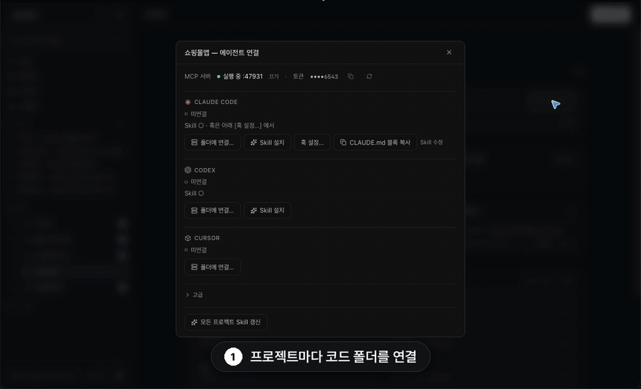
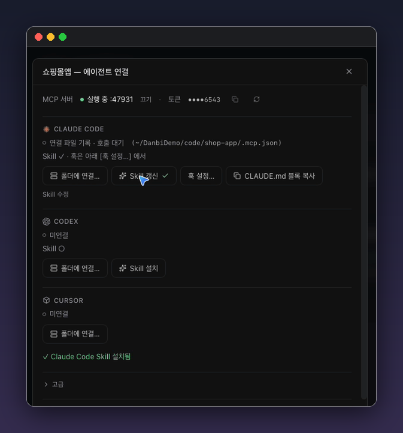
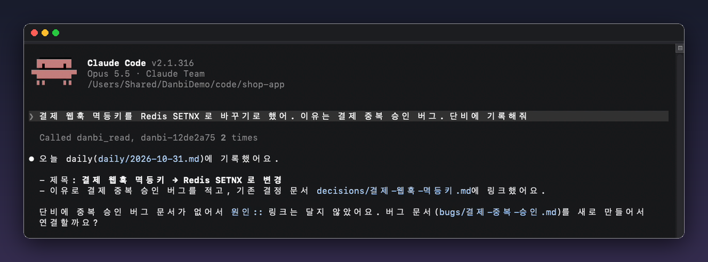
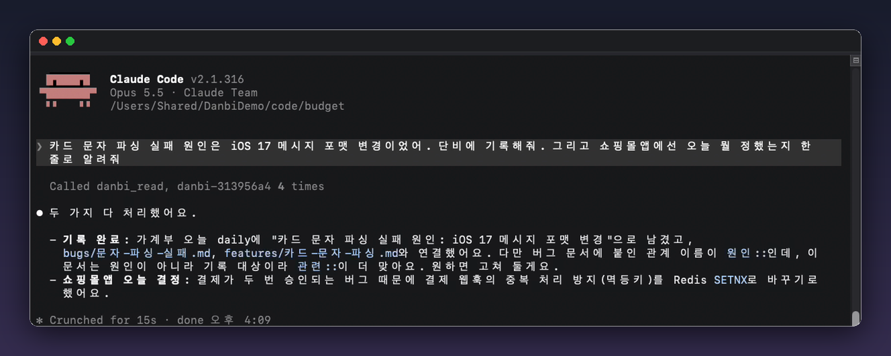
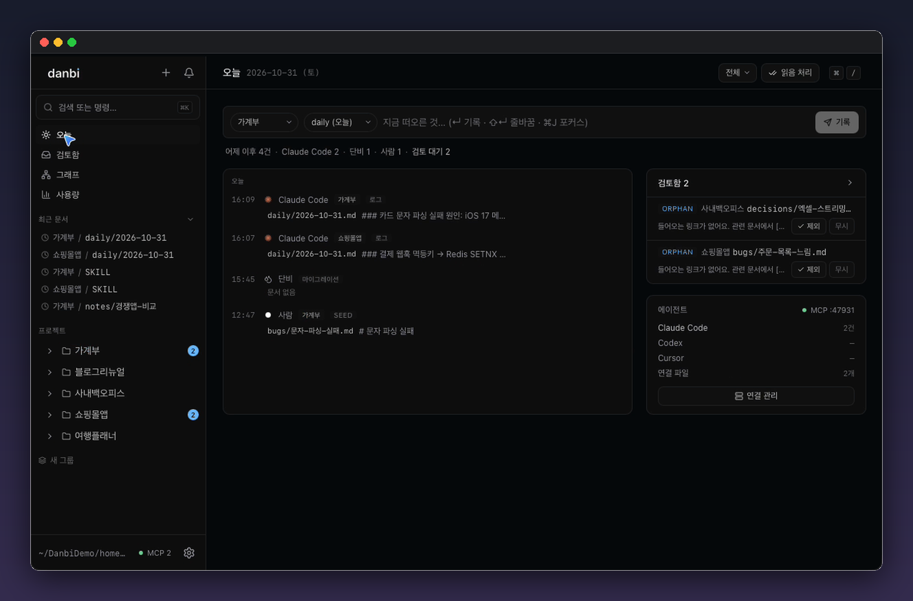
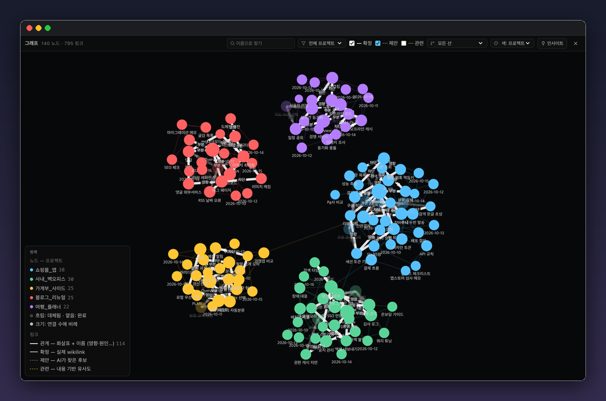
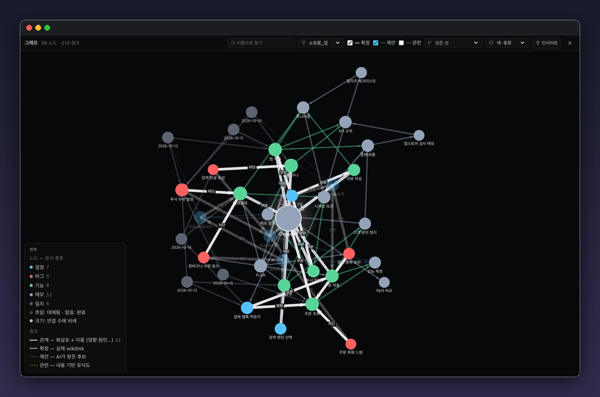

<p align="center">
  
</p>

<p align="center">
  
</p>

<p align="center">
  <b>사이드 프로젝트 여러 개를 Claude Code · Codex 로 굴리는 사람을 위한 LLM 위키.</b><br/>
  프로젝트마다 따로 기억하고, AI 가 직접 적고 꺼내 씁니다. 설치는 DMG 하나로 끝.
</p>

<p align="center">
  <a href="https://github.com/dean-studio/danbi/releases/latest">
    
  </a>
</p>

<p align="center">
  <sub>
    Apple Silicon · macOS 11+ ·
    <a href="https://github.com/dean-studio/danbi/releases">전체 버전</a> ·
    <a href="CHANGELOG.md">변경 기록</a> ·
    <a href="LICENSE">MIT</a>
  </sub>
</p>

<br/>

<p align="center">
  
</p>
<p align="center"><sub>코드 폴더 연결 → 각 폴더의 Claude Code 가 자기 프로젝트에만 기록 → 단비에서 기록·그래프 확인 · <a href="readme_imgs/danbi-demo.mp4">전체 영상 (1분 40초)</a></sub></p>

<br/>

## 이런 분께 만들었어요

회사 일에 사이드 프로젝트 두세 개, 전부 Claude Code · Codex 로 굴리고 계신가요?

- 새 세션을 열 때마다 **어제 정한 걸 처음부터 다시 설명**하고 있다면
- A 프로젝트 작업 중에 **B 프로젝트 이야기가 섞여 나와** 곤란했다면
- 노트는 쌓이는데 **"그거 어디 적었더라"** 를 매번 찾고 있다면

단비는 프로젝트마다 **따로 된 기억 공간**을 만들어 줍니다. Claude Code · Codex 가 작업하면서 결정 · 버그 원인 · 할 일을 직접 적고, 다음 세션에서는 필요한 조각만 꺼내 씁니다.

| | |
|---|---|
| 🗂 **프로젝트 단위로 나뉩니다** | 쇼핑몰 폴더에서 연 Claude Code 의 기록은 쇼핑몰 프로젝트에만 들어갑니다. 다른 프로젝트로 잘못 적힐 일이 구조적으로 없습니다. |
| ✍️ **AI 가 직접 적고 직접 찾습니다** | 사람이 따로 정리하지 않아도 됩니다. 쌓인 결과만 가끔 확인하면 됩니다. |
| 🔎 **한국어로 잘 찾습니다** | 한국어 n-gram 검색이 기본이라 "웹훅 중복" 으로 "웹훅-멱등키" 문서를 찾습니다. API 키 없이도 됩니다. |
| 📁 **전부 내 Mac 의 Markdown** | vault 폴더에 그대로 쌓이고, 저장할 때마다 git 으로 버전이 남습니다. 서버로 보내지 않습니다. |

## 이렇게 씁니다

### 1. 프로젝트마다 코드 폴더를 연결



프로젝트를 만들고 **[연결 관리]** 에서 Claude Code · Codex · Cursor 중 하나를 골라 코드 폴더를 선택하면 끝입니다.

단비가 그 폴더에 연결 파일(`.mcp.json` 등)과 Skill 을 대신 써 둡니다. 연결 파일은 git 에 올라가지 않도록 자동으로 제외해 둡니다.

프로젝트마다 쓰기 주소가 따로 나와서, 이 폴더에서 연 AI 는 **이 프로젝트에만** 기록할 수 있습니다. 읽기는 vault 전체에서 할 수 있어서 다른 프로젝트의 결정을 참고하는 건 됩니다.

<br clear="right"/>

### 2. 그 폴더에서 Claude Code 에 말하기

"이거 단비에 기록해줘", "어제 뭐 정했지?" 처럼 평소대로 말하면 됩니다. Claude Code 가 알아서 단비 도구를 골라 씁니다.

<p align="center">
  
</p>
<p align="center"><sub>쇼핑몰앱 폴더 — 결정을 말하면 쇼핑몰앱 daily 에 적고, 관련된 기존 결정 문서에 링크까지 겁니다.</sub></p>

<p align="center">
  
</p>
<p align="center"><sub>가계부 폴더 — 기록은 가계부로만. 쇼핑몰앱의 오늘 결정은 <b>읽기만</b> 해서 알려 줍니다.</sub></p>

### 3. 쌓인 기록은 단비에서 한눈에

<p align="center">
  
</p>
<p align="center"><sub>오늘 화면 — 어느 프로젝트에, 누가(Claude Code · 사람 · 단비), 언제 적었는지 시간순으로 보입니다.</sub></p>

### 4. 기억이 쌓이면 지도가 됩니다

<p align="center">
  
</p>
<p align="center"><sub>전체 그래프 — 프로젝트마다 색과 영역이 나뉩니다. 범례를 누르면 그 프로젝트만 강조돼요.</sub></p>

<p align="center">
  
</p>
<p align="center"><sub>프로젝트 하나 — 결정 · 버그 · 기능을 색으로, "원인 · 영향 · 차단" 같은 관계를 화살표로 봅니다.</sub></p>

<p align="center"><sub>화면의 프로젝트와 노트는 모두 데모용 예시 데이터입니다.</sub></p>

## 설치는 3분이면 끝

터미널 명령도, Python · Node · Docker 도 필요 없습니다.

1. **[DMG 내려받기](https://github.com/dean-studio/danbi/releases/latest)** → `단비.app` 을 Applications 로 드래그. 애플 공증을 받아 경고 없이 열립니다.
2. **처음 실행하면 마법사가** vault 폴더를 만들고 MCP 서버를 켭니다. AI 키는 건너뛰어도 됩니다.
3. **프로젝트를 만들고 [연결 관리]** 에서 AI 도구와 코드 폴더를 고릅니다.

이제 그 폴더에서 Claude Code 를 열고(이미 열려 있었다면 다시 시작) 말을 걸면 됩니다. 업데이트는 앱이 알아서 받습니다.

자세한 연결 방법과 실전 워크플로는 [docs/MCP_GUIDE.md](docs/MCP_GUIDE.md) 에 있습니다.

## 왜 단비인가요

AI 는 **새 대화창을 열 때마다 기억을 잃습니다.** 그래서 매번 같은 설명을 처음부터 다시 해 줘야 하고, 그 설명이 곧 시간과 토큰입니다. 단비는 AI 의 외장 메모리입니다.

```
나 ──▶ AI (Claude Code · Codex · Cursor) ──▶ 단비 ──▶ Markdown 노트 (내 Mac)
               ▲                              │
               └──────── 필요한 조각만 ───────┘
```

1. **세션을 열면** — AI 가 `danbi_briefing` 으로 어제 한 일 · 지금 유효한 결정 · 할 일을 받아 이어서 시작합니다.
2. **물어보면** — 단비가 노트 전체가 아니라 관련된 조각 몇 개만 골라 줍니다. 컨텍스트가 짧아지니 토큰이 덜 듭니다.
3. **결정하면** — AI 가 그 자리에서 `danbi_log` 로 기록합니다. 내일 새 세션에서도 그대로 이어집니다.

단비 자체는 AI 를 부르지 않습니다. 추론은 Claude Code 같은 AI 가 자기 환경에서 하고, 단비는 **노트장 + 검색 도우미** 역할만 합니다. 그래서 단비를 쓴다고 추가 요금이 나가지 않습니다.

<details>
<summary><b>한 프로젝트만 보이게 하면 뭐가 좋은가요?</b></summary>

<br/>

프로젝트마다 쓰기 주소(MCP endpoint)와 Skill 이 따로 만들어집니다.

```
~/.claude/skills/danbi-12de2a75/   ← 쇼핑몰앱 전용 Skill
~/.claude/skills/danbi-313956a4/   ← 가계부 전용 Skill
```

- 쓰기 도구는 **그 연결의 프로젝트로 고정**됩니다. 쇼핑몰 폴더의 AI 가 가계부에 메모를 남길 수 없습니다.
- 한 프로젝트 맥락만 보내니 다른 프로젝트 이야기가 답에 섞이지 않고, 컨텍스트도 짧아집니다.
- 프로젝트별로 차곡차곡 쌓여서, 1년 뒤에도 "이 프로젝트 1년 전 오늘" 을 돌아볼 수 있습니다.

</details>

<details>
<summary><b>검색은 어떻게 빠르고 정확한가요?</b></summary>

<br/>

- [tantivy](https://github.com/quickwit-oss/tantivy) 기반 BM25 + 한국어 n-gram 색인을 내 Mac 에서 미리 만들어 둡니다. 인터넷도, 임베딩 비용도 필요 없습니다.
- 노트가 많아도 관련 조각 몇 개만 추려서 AI 에 넘깁니다.
- (선택) Gemini · Bedrock 임베딩 키를 넣으면 의미 검색 결과를 [RRF](https://en.wikipedia.org/wiki/Reciprocal_rank_fusion) 로 합칩니다. "JWT 결정" 으로 "토큰 만료 정책" 같은 동의어 노트까지 찾습니다.

</details>

<details>
<summary><b>실제로 토큰이 얼마나 줄었나요? (2026-05-21 하루 측정)</b></summary>

<br/>

같은 사람이 같은 Mac 에서 하루 동안 작업한 대화 26개를, 단비를 쓴 대화(2개)와 안 쓴 대화(24개)로 나눠 1턴 평균을 비교했습니다. 작업 종류가 달라 엄밀한 실험은 아니고, 참고용입니다.

| 1턴 평균 | 단비 사용 | 단비 미사용 |
|---|---:|---:|
| 입력 토큰 | 약 1/2.5 | 기준 |
| 답 받기까지 | 약 41초 | 약 1분 10초 |
| 비용 | 약 절반 | 기준 |

내 환경에서 재보려면 `scripts/token-stats.py` 를 실행하세요.

</details>

## AI 가 쓰는 도구

연결만 해 두면 AI 가 알아서 골라 씁니다. 명령어를 외울 필요는 없고, 어떤 일을 시킬 수 있는지 감만 잡으시면 됩니다.

<details>
<summary><b>읽기 도구</b> — vault 전체에서 조회</summary>

<br/>

| 도구 | 이럴 때 |
|---|---|
| `danbi_briefing` | "어디서부터 이어 하면 돼?" — 최근 활동 · 유효한 결정 · 할 일 · 지난 daily 요약 |
| `danbi_context` | "결제 웹훅 관련해서 뭐 있었지?" — 질문에 맞는 섹션만 골라서 |
| `danbi_search` | "JWT 결정 어디 적었지?" — 키워드 · 자연어 검색 (한국어 OK) |
| `danbi_read` | "그 노트 보여줘" — 문서 전체 또는 특정 섹션 |
| `danbi_related` | "이거랑 관련된 문서는?" — 링크 · 내용으로 이어진 문서 |
| `danbi_recent` | "최근에 뭘 만졌더라?" — 최근 수정한 노트 |
| `danbi_daily` | "1년 전 오늘 뭐 했지?" — 오늘 · 어제 · 1주/1달/1년 전 daily |
| `danbi_list_projects` | "다른 프로젝트엔 뭐가 있더라?" — vault 전체 트리 |
| `danbi_query` | "지금 유효한 결정만" / "이 버그 원인은?" — 종류 · 상태 · 관계로 조회 |
| `danbi_schema` | "이 프로젝트는 어떤 종류 · 관계를 써?" — 프로젝트 어휘 |

</details>

<details>
<summary><b>쓰기 도구</b> — 연결된 프로젝트에만</summary>

<br/>

| 도구 | 이럴 때 |
|---|---|
| `danbi_log` | "이거 오늘 일지에 적어둬" — 오늘 daily 에 시각 · 호출자와 함께 추가 |
| `danbi_append` | "auth 노트에 붙여줘" — 특정 문서에 추가 (없으면 새로 만듦) |
| `danbi_create_file` | "결정 문서 새로 만들어줘" — 새 문서 생성 |
| `danbi_replace_section` | "이 섹션 최신으로 바꿔줘" — 문서의 한 섹션만 교체 |
| `danbi_upsert_item` | "할 일 목록에서 이거 완료로" — 목록 항목 추가 · 수정 |
| `danbi_create_folder` | "stats 폴더 만들어줘" — 프로젝트 안 하위 폴더 |
| `danbi_set_meta` | "이건 결정 문서, 예전 결정은 대체됨" — 종류 · 상태 · 관계 기록 |
| `danbi_propose_link` | "이 버그 원인 문서랑 이어줘" — 관계 링크 제안 (검토함에서 승인) |

</details>

## 기능

**키 없이 되는 것**

- 마크다운 에디터 (BlockNote), `[[위키링크]]` 로 문서 연결
- BM25 + 한국어 n-gram 검색
- 그래프 — 프로젝트 · 주제군별 색과 영역, 범례 강조, 문서 종류별 색, 관계 화살표
- 가벼운 온톨로지 — 문서 종류(결정 · 버그 · 기능…) · 상태(유효 · 대체됨 · 완료), `원인:: [[문서]]` 같은 관계 링크. 대체된 결정은 검색 · 브리핑에서 뒤로 밀립니다
- 오늘 화면 · daily 노트 · 1주/1달/1년 전 돌아보기
- 홈 빠른 메모 (⌘J)
- 프로젝트별 MCP 연결 + Skill 자동 생성
- 저장 = git 커밋, 휴지통 (30일 보관)

**AI 키를 넣으면 더해지는 것** (Gemini · Bedrock 등, 키는 macOS 키체인에만 저장)

- 의미 검색 (BM25 와 RRF 하이브리드)
- daily 요약, 카드형 공유 페이지 만들기
- 프로젝트 목적 · 스키마 자동 작성
- 관련 노트 연결 제안

AI 호출은 모두 사용자가 직접 눌렀을 때만 일어납니다. 백그라운드에서 몰래 부르지 않습니다.

## 자주 쓰는 단축키

| 단축키 | 동작 |
|---|---|
| ⌘J | 홈 빠른 메모 |
| ⌘K | 검색 · 명령 |
| ⌘G | 그래프 |
| ⌘S | 저장 |
| ⌘F | 노트 안 검색 |
| ⌘, | 설정 |

## 최근 업데이트

- **v0.9.4** — 문서 인스펙터 링크 탭에 연결 지도. 이 문서가 어느 프로젝트의 어떤 문서와 이어졌는지 한눈에 봅니다.
- **v0.9.3** — 그래프가 배치가 끝나면 화면에 꼭 맞게 잡힙니다.
- **v0.9.2** — 그래프 범례를 눌러 프로젝트 · 주제군 · 종류만 강조하고, 그 프로젝트로 바로 들어갑니다.
- **v0.9.1** — 그래프를 다시 그렸습니다. 둥근 원판 배치, 프로젝트 · 주제군별 색과 영역, 마우스를 올리면 이웃만 남기기.
- **v0.9.0** — 가벼운 온톨로지. 문서 종류 · 상태 · 관계, `danbi_query` · `danbi_schema` · `danbi_set_meta` · `danbi_propose_link`, 온톨로지 표.

[전체 변경 기록 →](CHANGELOG.md)

## 문서

- [INTRO.md](docs/INTRO.md) — 단비란 무엇인가, 왜 만들었나
- [MCP_GUIDE.md](docs/MCP_GUIDE.md) — Claude Code · Codex · Cursor 연결, 도구, 실전 워크플로
- [REST_API.md](docs/REST_API.md) — vault 에 직접 쓰는 HTTP API

## 개발

Tauri v2 (Rust) · Vite + React + TypeScript + Tailwind · BlockNote · tantivy · MCP HTTP 서버(axum) · git 기반 vault

```bash
pnpm install
pnpm tauri dev      # 개발 모드
pnpm bundle         # DMG 빌드 (Apple Developer 인증서 필요)
```

## 라이선스

소스 코드는 [MIT 라이선스](LICENSE)로 공개합니다. 누구나 자유롭게 쓰고, 고치고, 다시 배포할 수 있어요.

단, "Danbi" · "단비" 이름과 로고 · 앱 아이콘은 Dean Works inc. 의 상표라서 MIT 라이선스에 포함되지 않습니다([TRADEMARKS.md](TRADEMARKS.md)). 고쳐서 배포할 때는 다른 이름과 아이콘을 써 주세요.

버그 리포트 · 토론 · pull request 는 환영합니다.

© 2026 [Dean Works inc.](https://dean.kr)
